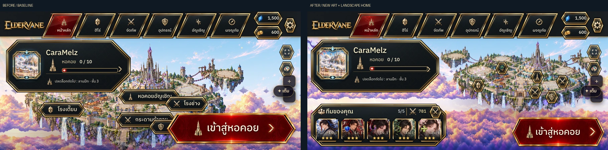

# Hero art refresh and landscape Home — 2026-10-30

User request: import the supplied new portraits/banners; shift the floating city right so the main island is centered, enlarge the upper-left profile/lower-left team without obscuring the main island, and prioritize landscape mobile.

21 supplied images were inspected: 11 portraits (Bailong,Yuezheng,Moye,Tangxun,Linxue,Garrick,Kael,Mirelle,Sylvara,Elira,Draeven) and 10 banners (same list except Draeven). `syl` maps to the supplied elf archer Sylvara, not Sylas. Original ZIP: [source archive](../../assets/ui/hero-refresh-2026-10-30.zip). [All supplied images contact sheet](references/all-supplied-images.jpg). [Import manifest](../hero-art-refresh-2026-10-30.json) records dimensions and source/runtime hashes.

Importer: `python3 tools/dev/import_hero_ui_art.py`. Runtime WebP images retain the complete source aspect ratio, with portraits capped at768 pixels and banners at1600 pixels on the longest edge (no upscaling/cropping). Source PNGs are retained unchanged in the ZIP. Skills/sprites and protected `assets/heroes/Kael/**`/`art/incoming/**` are untouched. Portrait widgets keep their existing face crops inside fixed frames; hero-detail banners continue displaying the complete image.

Home now reserves a landscape camera region beside the profile and above the footer. It fits the main island body/spire, centers it in the free region to the right, and permits the negative camera pan needed for that composition. All world art, canvas effects, hit targets and labels share the camera. Satellites may occupy the surrounding margins. Default zoom is tested against profile/team/tower-action bounds; manual zoom/focus can enlarge the island beyond that default region. Classic island camera behavior is unchanged.

Profile at1600×900 grows from350×148 to460×180, and team from430×134 to590×177. Shorter landscape displays adapt panel sizes; the team remains visible at844×390 (previously hidden). Distant building labels collapse to emblems to avoid hiding the small island; hover/focus still reveals names, and the original named building tap targets open their existing dialogs. Front/back cloud seas extend to the viewport edge when the camera shows more sky.

## Real game comparison

The previous implementation is the layout baseline; the user's new size/position request intentionally changes it. No new target UI drawing was supplied. All screenshots are from the running game atDPR2, CaraMelz, tower0/10, same default team. Review screenshots use WebP quality94 at their original captured dimensions. Side-by-side sheets only resize and arrange the two real captures; no generated artwork or retouching is used. Uncompressed landscape-mobile originals: [before PNG](home-before-844-original.png) and [after PNG](home-after-844-original.png).

| CSS viewport | Before / reference | Actual after | Side by side |
| --- | --- | --- | --- |
|1600×900|[Before](home-before-1600.webp)|[After](home-after-1600.webp)|[Compare](compare-1600.webp)|
|1335×533|[Before](home-before-1335.webp)|[After](home-after-1335.webp)|[Compare](compare-1335.webp)|
|1024×600|[Before](home-before-1024.webp)|[After](home-after-1024.webp)|[Compare](compare-1024.webp)|
|844×390|[Before](home-before-844.webp)|[After](home-after-844.webp)|[Compare](compare-844.webp)|
|740×360|—|[After](home-after-740.webp)|—|
|667×375|—|[After](home-after-667.webp)|—|

## Supplied artwork versus actual game

| Source reference | Actual game |
| --- | --- |
|[Bailong banner](references/bai_banner.png)|[Desktop](hero-bailong-1600.webp) · [Landscape mobile](hero-bailong-844.webp)|
|[Yuezheng banner](references/yue_banner.png)|[Desktop](hero-yuezheng-1600.webp) · [Landscape mobile](hero-yuezheng-844.webp)|
|[Elira banner](references/elira_banner.png)|[Desktop](hero-elira-1600.webp) · [Landscape mobile](hero-elira-844.webp)|
|[Draeven portrait](references/dra_portrait.png)|[Profile picker with new Draeven selection](profile-picker.webp)|

[Hero collection](collection-844.webp). Screenshots for Draeven's hero detail retain his existing banner because the supplied update contains only his portrait.

## Validation

- Source ZIP/file names and21 image decodes validated before replacing runtime art; all dimensions, hashes and source aspect ratios verified afterwards.
- App/spec TypeScript checks,902/902 Karma tests and production build pass (existing warnings retained). No gameplay changes, so no balance retuning/simulation was needed.
- Actual browser checks at six landscape sizes: default main-island bounds do not intersect profile/team/tower action; tower tap targets open the correct dialog before and after zoom. Profile picker applies the new Draeven image to Home.22 hero-banner/viewport ratio checks pass; zero page errors or failed image requests. [Full measurements](browser-verification.json).
- Browser-only synthetic roster was used to inspect all11 updated heroes; source game saves/starter data were not changed.

Aesthetic review remains with the user. Branch `fix/hero-art-landscape-home`; no master merge or deployment in this task. Earlier published changes remain intact.
