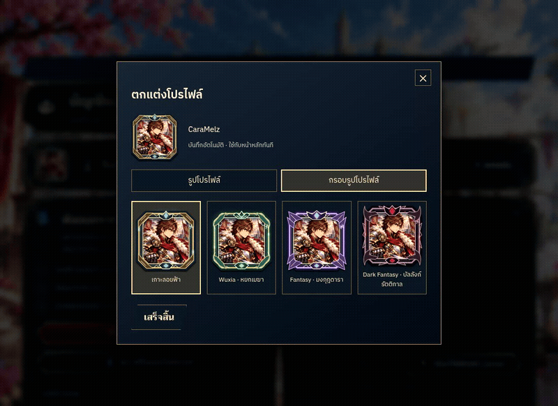

# Animated profile frames — review, 2026-10-29

User asked to make the four frame themes more ornate, with flowing and sparkling effects. The previous implementation is the baseline, not the visual target for the new ornaments. No separate design reference was supplied for these frames.

| Before / reference | Actual game after |
| --- | --- |
| [Previous frame selection](../profile-review/customize-1440.png) | [New desktop frame selection](desktop.png) |
| [Previous Home](../profile-review/home-1440.png) | [New Home with Dark Fantasy](home.png) |
| [Previous mobile frame selection](../profile-review/customize-390.png) | [New mobile frame selection](mobile.png) |

[Original browser recording](preview.webm) · [Reduced motion](reduced-motion.png)

Actual screenshots: Chromium, DPR 2, desktop 1440×1000 and mobile 390×844. Baseline desktop screenshots are 1440×900, so the outer page height differs. Test data CaraMelz, Kael portrait, floor 0/10. GIF is an excerpt of the actual browser recording at 1100×800, resized to 800 pixels wide, with no generated artwork substituted for the application.

- Island: architectural gold fittings and sky crystal.
- Wuxia: jade cloud scrollwork, lotus seal and green light.
- Fantasy: winged star crown, lavender metal and luminous crystal.
- Dark Fantasy: obsidian horns/thorns, garnet seal and crimson embers.

Shared SVG contours preserve equal corner cuts and contain the portrait. Two traveling light trails, intermittent star glints, breathing halos and six drifting motes decorate the border. Art remains stationary. CSS only, no animation timers or runtime dependencies. Decorative elements are hidden from accessibility APIs and ignore pointer input. Reduced-motion preference disables the effects.

Validation: app/spec TypeScript checks, production build, 890/890 Karma tests. Real browser checked Home and Account on desktop/mobile, all theme selections, changing computed stroke-dashoffset over time, and animation-name:none under reduced motion. No page errors. Build retains existing template/CommonJS/budget warnings. No gameplay/save-format change. No deploy or master merge. User reviews aesthetics.
